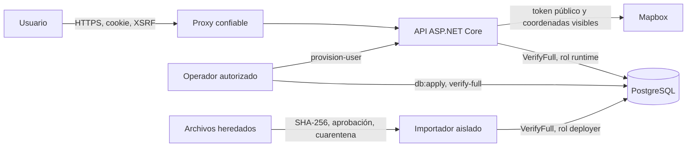

# Modelo de amenazas de GDS Mine

**Versión revisada:** 19 de octubre de 2026  
**Alcance:** Angular, API ASP.NET Core, PostgreSQL, comandos administrativos, importación heredada y borde HTTP.  
**Fuente:** código del repositorio y escaneo estándar `d0331dac-f35b-4f37-9ae2-89c13a9be54d`.

## 1. Panorama y arquitectura

La aplicación registra incidencias georreferenciadas y exige validar en orden las fases de indicios, reconocimiento, vigilancia y mitigación. Angular consume rutas relativas `/api`; el backend usa ASP.NET Core Identity, cookie de sesión y antiforgery. Identidad, incidencias, catálogos, validaciones, eventos y auditoría se guardan en PostgreSQL. El aprovisionamiento, la aplicación del DDL y la importación heredada se ejecutan como comandos administrativos separados de la API.

| Componente | Función | Evidencia |
| --- | --- | --- |
| Angular | Login, captura de cuatro fases, historial y mapa | `src/app/app.config.ts:12-19`, `src/app/app.routes.ts:4-39` |
| API | Autenticación, autorización, catálogos e incidencias | `backend/Program.cs:8-119` |
| Sesión | Cookie, sello, roles, CSRF y rate limiting | `backend/Auth/SessionAuthentication.cs:18-86` |
| Persistencia | Ownership, concurrencia, fases, evento y auditoría transaccional | `backend/Data/PostgresNoteRepository.cs:21-220` |
| PostgreSQL | Integridad, inmutabilidad, roles y privilegios | `backend/Database/apply.sql:720-999`, `backend/Database/apply.sql:1152-1211` |
| Importador | Análisis, aprobación por huella, cuarentena y carga | `backend/Import/LegacyImportCommand.cs:43-157`, `backend/Import/PostgresLegacyImportSink.cs:27-239` |

Los recursos sensibles y su valor efectivo son:

| Flujo | Recurso | Control local | Puerta externa |
| --- | --- | --- | --- |
| API → PostgreSQL | `ConnectionStrings__Postgres` | Production/Staging exige `VerifyFull`; no acepta `Trust Server Certificate=true` | Servidor con `hostssl`, SAN y CA; comprobar `pg_stat_ssl` |
| DDL/importación → PostgreSQL | `POSTGRES_DEPLOY_URL` | Los wrappers exigen `sslmode=verify-full` antes de abrir conexión | Rotación y entrega desde gestor de secretos |
| Réplicas API | `DataProtection:KeyRingPath` | Obligatorio fuera de Development/Testing | Volumen compartido, permisos, respaldo y rotación |
| SPA → Mapbox | `MAPBOX_PUBLIC_TOKEN` | Solo acepta formato público `pk.*` | Restringir origen y scopes en la cuenta Mapbox |
| Navegador heredado | `gds-detection-cases-v1` | El bundle nuevo no lo lee ni borra | Exportar/conciliar o eliminar con aprobación por perfil |

## 2. Activos, límites de confianza y supuestos

Activos protegidos:

- cuentas, hashes, roles, sellos de seguridad y cookies;
- incidencias, coordenadas, evidencias y datos de las cuatro fases;
- atribución del propietario y del validador, orden de fases y revisión;
- catálogos, eventos y auditoría append-only;
- originales heredados, mapas de propietario/zona y conciliación;
- cadenas PostgreSQL, keyring y configuración del proxy.

Actores y capacidades iniciales:

- un visitante anónimo puede pedir health/CSRF e intentar login, pero no posee cookie firmada ni roles;
- un operador autenticado puede elegir IDs y datos, pero solo debe ver sus incidencias y no puede validar fases;
- un validador puede validar incidencias propias en el orden permitido; un administrador también puede aprovisionar;
- un adversario de red puede observar o suplantar servicios si la infraestructura omite TLS verificado;
- un operador de importación controla rutas y archivos de entrada, pero la aprobación debe quedar ligada a una huella y a un usuario administrador existente.

Invariantes:

- toda ruta privada exige identidad; cada incidencia se filtra por propietario;
- solo `validador` o `administrador` valida y ninguna fase avanza antes de la anterior;
- datos, validación, evento y auditoría se confirman o revierten juntos;
- ningún consumidor productivo de PostgreSQL acepta downgrade de certificado/nombre;
- respuestas y logs no exponen contraseña, cookie, token o cadena de conexión;
- el bundle no atribuye datos locales heredados a la cuenta que acaba de iniciar sesión.

Supuestos pendientes de evidencia: el proxy fuerza HTTPS y reemplaza encabezados reenviados; el servidor PostgreSQL ofrece TLS confiable; el keyring es compartido y protegido; la CSP final fue ensayada con Mapbox; el token público está restringido; los perfiles antiguos fueron saneados.

## 3. Superficie, mitigaciones e historias de atacante

| Prioridad | Escenario y capacidad obtenida | Prerrequisitos | Controles existentes | Acción pendiente |
| --- | --- | --- | --- | --- |
| Alta | Robo de sesión o acceso cruzado a incidencias | Fallo de cookie, ownership o revocación | Cookie HttpOnly/Secure, sello por petición, fallback autenticado y ownership SQL | Validar dos cuentas en entorno real |
| Alta | Alterar el orden o firmar una fase sin rol | Usuario autenticado de menor privilegio | `CanValidatePhase`, revisión optimista, transacción y triggers SQL | Probar concurrencia entre instancias |
| Alta | Suplantar PostgreSQL y capturar credencial | URL o servidor sin verificación completa y posición de red | Fail-fast `VerifyFull` en API, importador y `db:apply` | Habilitar TLS real y comprobar handshake/`pg_stat_ssl` |
| Media | CSRF desde un origen externo | Sesión activa de la víctima | Token antiforgery en login/logout/mutaciones y CORS exacto | Repetir desde el host público |
| Media | XSS mediante texto de incidencia o catálogo | Contenido controlado por usuario | Escape Angular; popups con `textContent` o escape explícito; framing bloqueado | Aplicar CSP final tras observar Mapbox |
| Media | Importar datos manipulados como válidos | Acceso al comando deployer y archivos alterados | SHA-256 confirmado, aprobador administrador, cuarentena, locks y originales protegidos | Ejecutar prueba PostgreSQL aislada |
| Media | Reutilizar un blob local entre cuentas | Perfil con bundle/datos anteriores | Bundle nuevo no lee ni borra el blob | Conciliar o eliminar por perfil |
| Baja | Agotar login o listas | Solicitudes repetidas | 4 KiB en login, 1 MiB global, rate limit y máximos de consulta | Añadir límite distribuido en ingress si hay réplicas |

Estas filas son escenarios para verificación. El escaneo estándar validó un hallazgo medio en el wrapper de DDL; se corrigió exigiendo un único `sslmode=verify-full` antes de iniciar `psql`. Las demás filas representan controles comprobados localmente o puertas del entorno, no vulnerabilidades confirmadas.

## 4. Calibración de severidad

- **Crítica:** compromiso directo y reproducible de múltiples cuentas, credenciales productivas o control administrativo sin autenticación ni prerrequisitos materiales.
- **Alta:** lectura o modificación de incidencias ajenas, bypass de rol/orden de fases o control de la base con una ruta realista y pocos prerrequisitos.
- **Media:** alto impacto condicionado a una configuración insegura o posición de red, o impacto acotado con una ruta alcanzable. El downgrade TLS de `db:apply` se clasificó aquí antes de corregirse.
- **Baja:** impacto reducido, mismo usuario o prerrequisitos poco probables sin una escalada clara.

La ausencia de evidencia del servidor, proxy o proveedor reduce la confianza sobre el despliegue, no demuestra que el control exista. Por eso esas verificaciones permanecen abiertas en el checklist aunque el análisis de código haya terminado.
